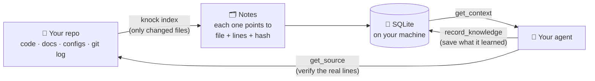

<div align="center">

# 🚪 knock

### Give your AI coding agent a memory of your codebase.

*Stop paying your agent to re-read the same files every session. Knock first, then read only what matters.*

[](LICENSE)




<sub>A real Claude Code session on <a href="https://github.com/pallets/flask">Flask</a> 3.1.2, abridged (two shell commands collapsed into one line). Claude asked knock first, then read only the lines it needed.</sub>

</div>

---

## 🤔 The problem, in one table

Every new chat with a coding agent starts with amnesia. To answer *"where is X?"* or *"how do we deploy?"* it greps, opens big files, reads them... and next session it does it **all over again**.

| | 😩 Without knock | 😎 With knock |
|---|---|---|
| **First move** | `grep` around, open 3 whole files | one `get_context` call |
| **Text the agent reads** | ~27,000–118,000 characters per question | ~4,300 characters per question |
| **Finds "why did we do it this way?"** | only if it opens the right doc | decisions and their rationale come back with the answer |
| **Remembers yesterday's bug hunt** | ❌ | ✅ agents save findings with `record_knowledge` |
| **Knows when its notes are outdated** | — | ✅ every answer says `fresh` or `stale` |

<sub>Median characters per task on the <a href="docs/benchmark.md">held-out benchmark</a> (targeted-grep and grep-and-read baselines vs knock). Fewer characters ≠ an identical cut in your bill; see the <a href="#-faq">FAQ</a>.</sub>

## ⚡ Getting started

**You set knock up once, then you just keep using your AI agent as usual.** The agent talks to knock in the background; you never have to run knock commands day to day.

### 1️⃣ Install knock (once)

```bash
git clone https://github.com/HasanGilani/knock.git && cd knock
python3 -m venv .venv && source .venv/bin/activate && pip install -e .
```

### 2️⃣ Connect it to your agent (once per project)

From inside the project you work on, for **Claude Code** (in the same terminal as step 1, so `which knock` finds it):

```bash
cd ~/code/my-project
claude mcp add knock -- "$(which knock)" serve --repo .
```

That's the whole setup. The next time you open Claude Code in that project, knock reads the project and builds its notes automatically. This takes a few seconds the first time; after that it only re-reads files that changed.

> [!TIP]
> Add this line to your project's `CLAUDE.md` so the agent uses knock when it pays off:
> *"Before exploring the repo (how/why questions, unclear bugs, changes across modules, code you can't find with one search), call knock's `get_context`. For small edits you can locate with one grep, skip it. Save reusable findings with `record_knowledge`."*
>
> In our recordings, knock saved money on investigations in a large codebase but added a small cost to quick edits, so this line matters.

### 3️⃣ Work normally

Ask your agent what you'd always ask. Here's what changes behind the scenes:

| You type | What the agent does |
|---|---|
| *"Add rate limiting to the login endpoint"* | asks knock first and gets the login handler's `file:line`, your middleware conventions and the test setup, then opens only those lines |
| *"Why do we use Postgres instead of Mongo?"* | gets the decision and its reasoning from your docs or ADRs, with a link to the source |
| *"Tests fail with a Redis error, any idea?"* | finds the finding a previous session saved: *"login tests need Redis running"* |
| *(after it figures something out)* | saves it with `record_knowledge`, so tomorrow's session already knows |

Nothing to maintain: when code changes, knock updates its notes, and flags anything that may be outdated.

<details>
<summary><b>🖥️ Optional: use knock yourself from the terminal</b></summary>

<br>

You never *need* these, but they're handy. They're also what the demo at the top shows.

| Command | When you'd use it |
|---|---|
| `knock context "how do we deploy?"` | ask a question yourself, e.g. when onboarding onto an unfamiliar repo |
| `knock search "rate limit"` | look up what knock knows about a topic |
| `knock status` | check how fresh the notes are and how much knock knows |
| `knock index .` | update the notes right now; your agent normally does this for you |
| `knock index . --full` | rebuild everything from scratch after a huge refactor |
| `knock forget . --yes` | delete everything knock stored about this project |

Want knock to ignore some files? List them in a `.knockignore` file (same format as `.gitignore`).

</details>

<details>
<summary><b>👥 Setting it up for a whole team</b></summary>

<br>

Commit a `.mcp.json` file to your repo, and every teammate's Claude Code picks up knock automatically (each person needs knock installed):

```json
{
  "mcpServers": {
    "knock": { "command": "knock", "args": ["serve", "--repo", "."] }
  }
}
```

Each person's notes live on their own machine. Sharing findings across a team isn't supported yet (see Status below).

</details>

## 🧠 How it works



1. **Index:** knock reads your repo *without running anything in it*. It writes short notes: what each module defines, what the docs say about setup and deployment, which tools and dependencies you use, why decisions were made, and which recent commits fixed bugs.
2. **Ask:** your agent asks a question and gets a small, ranked answer with `file:line` pointers, instead of reading whole files.
3. **Verify:** before editing, the agent reads just the lines it needs. The original files are always the source of truth.
4. **Remember:** the agent saves what it learned. If those files change later, knock marks the note **stale** so nobody trusts outdated info.

## 🧰 What your agent gets

| Tool | | What it does |
|---|---|---|
| `get_context` | 🔎 | **Start here when you'd otherwise explore.** A ranked package for a task: notes, functions with `file:line`, files worth opening, related commits, and honest "nothing known about X" gaps |
| `search_knowledge` | 📚 | Search notes, filtered by category (architecture, decision, workflow, …) or folder |
| `get_knowledge` | 🧾 | One note with full provenance: where it came from, when, and whether it is still current |
| `get_source` | 📄 | Read real lines from a file, with secrets redacted. Only files knock indexed |
| `record_knowledge` | ✍️ | Save a finding; duplicates are merged, contradictions flagged |
| `update_knowledge_status` | ✅ | Mark a note verified, or wrong |
| `get_repository_status` | 🩺 | How fresh the index is, plus counts and stats |
| `refresh_repository` | 🔄 | Re-index changed files (takes milliseconds, no AI calls) |

<details>
<summary><b>👀 See a real example session</b></summary>

<br>

On Flask, an agent is told: *"sessions signed with an old key in `SECRET_KEY_FALLBACKS` are rejected after rotating `SECRET_KEY`"*.

1. **`get_context`** returns ~7.7 KB containing:
   - `src/flask/sessions.py:317`: `SecureCookieSessionInterface.get_signing_serializer`
   - `tests/test_basic.py:374`: `test_session_secret_key_fallbacks`
   - related commits `fb54159861 secret key rotation: fix key list ordering` and `e13373f838 enable secret key rotation`
   - the docs sections on sessions and secret keys
2. **`get_source("src/flask/sessions.py", symbol="get_signing_serializer")`** returns the ~80 relevant lines, not the whole file.
3. **`record_knowledge`** saves the finding:
   ```json
   {"category": "debugging",
    "content": "get_signing_serializer builds the key list as SECRET_KEY_FALLBACKS followed by SECRET_KEY; ordering was fixed in fb54159.",
    "sources": [{"path": "src/flask/sessions.py", "start_line": 317, "end_line": 335}]}
   ```
   The next session gets it instantly. If `sessions.py` changes, the note is flagged **stale**.

</details>

## 📊 Does it actually help?

Measured with a reproducible benchmark: 12 engineering tasks per repo, covering architecture, finding a feature, deployment, bug investigation, design rationale and following conventions.

**Held-out repo** ([full-stack-fastapi-template](https://github.com/fastapi/full-stack-fastapi-template); knock was never tuned on it):

| Approach | Found the needed facts | Characters read | Tool calls |
|---|:---:|---:|---:|
| 🐢 grep + read 3 files | 9 / 12 | 1,215,570 | 72 |
| 🐇 targeted grep + read snippets | 7 / 12 | 328,206 | 60 |
| 🚪 **knock** | **10 / 12** | **88,962** | **17** |

<details>
<summary><b>More numbers, and the fine print</b></summary>

<br>

- **Flask** (used during development, so optimistic): knock 12/12 with 92K chars, baselines 7/12 with 2.1M and 247K chars.
- **Speed:** a ~200-file repo indexes in 0.3–0.6 s; re-indexing with no changes takes ~30 ms.
- **What this measures:** whether the facts *reached* the agent, not whether the agent then solved the task. The baselines are simulations of agent behaviour.
- **In real Claude Code sessions** (3 runs each), the result depends on the repository and the task:
  - **Flask** (small and well known): knock was break-even on a bug investigation and slightly *more* expensive on an easy edit, where its extra steps outweigh a single search.
  - **Saleor** (4,776 files, released days before the test), with the compact `map` toolset: on a multi-module investigation, knock cut the median cost from **$0.49 to $0.29** and model time from 170 s to 78 s, and every knock run was cheaper. On a follow-up edit whose file one regex search found, knock cost more ($0.14 vs $0.08).
  - **Latest version** (adds edit mode and "skip knock for easy edits" guidance), over the full investigate-then-edit scenario: Saleor's median two-day cost fell from **$0.70 to $0.43 (−39%)**. On Flask it was $0.31 vs $0.27, within run-to-run noise. Claude followed the guidance: it used knock for every investigation and skipped it for all the Flask edits.
  - Details and caveats are in [docs/benchmark.md](docs/benchmark.md#large-repository-saleor-real-claude-code-sessions).
- **Not yet measured:** real billed tokens with a live model. The harness is ready (`benchmarks/agent_bench.py`) but costs API credits to run.
- **Where knock missed:** wording mismatches ("linters" vs "lint") and module-level variables it doesn't index yet.

Full methodology: [docs/benchmark.md](docs/benchmark.md).

</details>

## 🔒 Your code stays yours

- 💻 **Everything is local:** one SQLite file in `~/.knock`. No cloud, no telemetry, no network calls (a test enforces this).
- 🙈 **Secrets are skipped:** `.env` files, keys and credentials are never indexed, and tokens or passwords inside code are redacted.
- 🧱 **Nothing is executed:** knock never runs your scripts, hooks or tests. It only reads.
- 🚧 **Sandboxed reads:** agents can only fetch files knock indexed, never `../../anything`.

> [!IMPORTANT]
> Whatever your agent retrieves through knock goes into the agent's context, just as if it had read the file itself. Exclude anything sensitive with a `.knockignore` file. Details: [docs/security.md](docs/security.md).

## ❓ FAQ

<details>
<summary><b>So it saves tokens?</b></summary>

That's the goal, and the benchmark shows far less text reaching the agent. But your bill also includes system prompts, reasoning, and output, and prompt caching already discounts repeated input. Expect the biggest wins on exploration-heavy questions ("how does X work?", "where is Y?", "how do we deploy?"), and little on pure code-writing. Faster answers and memory across sessions are wins either way.
</details>

<details>
<summary><b>Do I need an API key or a paid model?</b></summary>

No. Indexing and search are fully deterministic and local. The only thing that uses an API is the optional benchmark.
</details>

<details>
<summary><b>Which agents work with it?</b></summary>

Any agent that supports MCP over stdio. Verified: **Claude Code** (the session at the top of this page is a real recording of Claude using knock's tools) and the official MCP Python SDK client (all 8 tools, in the test suite). Cursor, Windsurf and others should work but are untested. Setup: [docs/agents.md](docs/agents.md).
</details>

<details>
<summary><b>Which languages and files does it understand?</b></summary>

Python (deeply, via its syntax tree), plus JavaScript/TypeScript, Go, Rust, Java, Kotlin, C#, Ruby, PHP, Swift, C/C++ and more. It also reads Markdown and reStructuredText docs, ADRs, `package.json`, `pyproject.toml`, `go.mod`, `Cargo.toml`, Dockerfiles, Makefiles, GitHub Actions, linter configs and git history. Full list: [docs/architecture.md](docs/architecture.md#supported-files).
</details>

<details>
<summary><b>What if the docs are wrong or outdated?</b></summary>

Every note is labelled with where it came from (`extracted from docs`, `recorded by an agent`, `git history`) and how fresh it is. Agents can mark a note as wrong, and it stays hidden until the source changes. The real file is always one `get_source` away.
</details>

<details>
<summary><b>How is this different from "RAG over my repo"?</b></summary>

No embeddings and no vector database. knock stores **small structured facts that point back to exact lines**, tracks when those lines change, and lets agents add what they learn. It's closer to a team wiki that maintains itself than to a search index.
</details>

## 🗺️ Status

knock is an early **MVP** (v0.1). What works today and what's next:

- [x] Incremental, resumable indexing that respects `.gitignore` and skips secrets
- [x] Structured knowledge with sources, freshness and lifecycle
- [x] MCP server with 8 tools, caching and local metrics
- [x] Reproducible benchmark with a held-out repo
- [ ] Model-in-the-loop token and cost benchmark (harness ready)
- [ ] Prototype: compact 3-tool "code map" (`--toolset map`), still being measured in real Claude Code sessions
- [ ] Smarter matching for synonyms, and indexing module-level variables
- [ ] Optional AI-assisted extraction (opt-in, disclosed)
- [ ] Sharing knowledge across a team

## 🤝 Contributing

Issues and PRs are welcome. Start with [CONTRIBUTING.md](CONTRIBUTING.md).

```bash
.venv/bin/pip install -e '.[dev]' && .venv/bin/pytest
```

Deeper docs: [Architecture](docs/architecture.md) · [Security](docs/security.md) · [Agents](docs/agents.md) · [Benchmark](docs/benchmark.md) · [Troubleshooting](docs/troubleshooting.md)

## 📜 License

[Apache-2.0](LICENSE)
